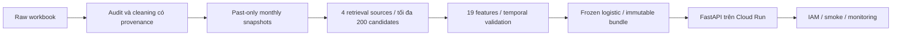

# Demo phỏng vấn: repeat-first recommender

## Mức độ hoàn thiện — chỉ nói theo bằng chứng

| Hạng mục | Trạng thái | Bằng chứng / giới hạn |
| --- | --- | --- |
| Data audit và cleaning có provenance | Đã kiểm chứng | 1.067.371 normalized rows, 1.004.211 paid rows; raw hash giữ nguyên; README và cleaning report |
| Temporal retrieval, features và validation | Đã kiểm chứng offline | Strict past-only boundaries, future-data invariance, frozen policies; baseline/model tables trong README |
| Logistic release, API, Docker | Đã kiểm chứng | Bundle hashes và API/offline equivalence; artifact source `b4accd8` |
| Manual Cloud Run deployment | Đã kiểm chứng | IAM-protected historical demo; deployment receipt và smoke report đã ghi |
| Original five-client cloud run | Có một lỗi chưa rõ nguyên nhân | 249/250 thành công, p95 27,125 ms; giữ failed zero-error gate |
| Single instrumented follow-up | Đạt trong mẫu đo mới | 250/250, p95 22,310 ms, khoảng 5,043 s; không tái hiện lỗi cũ |
| Offline CI | Đã pass | 107 tests và Docker build ở PR #3; CI PR #4 cũng pass trước merge |
| GitHub OIDC deployment và rollback | Đã xác minh live | Attempt 3: revision 00001 → 00002 → 00001, changed_traffic true, smoke cả hai revision pass; xem OIDC verification report |
| Alert policies / email delivery / full alert path | Chưa xác minh live | Tooling đã có; ba mức cần bằng chứng riêng |
| Client cold-start | Chưa xác nhận | Không có fresh explicit zero-instance evidence trước request |
| Business lift | Chưa đo | Không có A/B test, revenue/conversion attribution hoặc recommendation exposure data |
| Final held-out model evaluation | Chưa làm | Test snapshot descriptive statistics đã có từ giai đoạn đầu; chưa dùng test để đánh giá model/tuning |

PR #4 đã merge tại `2b21696656722163e9f9b2c41f60a031e9ea2251`. Điều này
lưu bằng chứng diagnostic, không tự chạy workflow release. Cập nhật các dòng
pending chỉ sau khi đọc receipts trong [checklist vận hành](operations-checklist-vi.md).

## Walkthrough 2–3 phút

**0:00–0:25 — Bài toán và phạm vi**

“Em xây dựng hệ thống gợi ý sản phẩm cho khách hàng quay lại, ưu tiên những sản
phẩm họ có khả năng mua lại. Em dùng hơn một triệu dòng giao dịch Online Retail
II và mô phỏng dự đoán tại đầu mỗi tháng. Mục tiêu kinh doanh kỳ vọng là hỗ trợ
repeat orders; hiện em chưa có bằng chứng về tăng doanh thu thực tế.”

**0:25–0:55 — Dữ liệu và thời gian**

“Em phát hiện hai sheet chồng lấn và có nhiều business rows giống nhau. Em giữ
dữ liệu gốc, lưu source sheet/row, loại duplicate extras theo policy và phân
biệt cancellations, anonymous customers, non-merchandise và mã chưa rõ. Lịch sử
và features chỉ dùng giao dịch trước cutoff. Em có tests cho cutoff boundaries
và việc thêm giao dịch tương lai không làm đổi lịch sử, eligibility hoặc catalog.”

**0:55–1:30 — Retrieval và kết quả ML**

“Bốn retrieval sources tạo tối đa 200 candidates cho mỗi customer-month, rồi
ranker dùng 19 past-only features để chọn top 10. Trên 1.817 validation queries
có known-catalog purchases, logistic nâng NDCG@10 từ khoảng 0,3351 lên 0,3780,
tương đương khoảng 12,8% cải thiện tương đối so với heuristic tốt nhất. Em cũng
đánh giá candidate recall và oracle ceilings để phân biệt retrieval misses với
ranking errors.”

**1:30–2:05 — Quyết định model và phục vụ**

“XGBoost dẫn nhẹ về validation NDCG, nhưng chênh lệch với logistic chỉ khoảng
0,00146 và paired customer-cluster interval chứa zero. Em chọn logistic cho
Release V1 vì gap quan sát được nhỏ, model artifact nhỏ hơn khoảng 66 lần và
warm scoring nhanh hơn. Em đóng gói model, preprocessing, feature schema,
precomputed candidates và metadata thành immutable bundle, sau đó deploy API
có xác thực lên Cloud Run.”

**2:05–2:45 — Kết quả vận hành và giới hạn**

“Cloud smoke checks đã xác minh known-customer rankings khớp offline và unknown
customers nhận popularity fallback. Một diagnostic run mới có 250/250 request
thành công ở năm clients, p95 khoảng 22,3 ms. Em vẫn giữ lần đo cũ có một request
lỗi chưa rõ nguyên nhân. Các lượt đo ngắn này không chứng minh sustained capacity.
Discovery còn yếu, cold-start chưa xác nhận và held-out model test chưa thực hiện.”

**2:45–3:00 — Cập nhật vận hành theo bằng chứng**

Hiện nói: “Em đã xác minh deploy qua GitHub OIDC và rollback giữa hai revision
của cùng frozen image. Run 42149437150 attempt 3 deploy revision 00002, trả 100%
traffic về 00001 và smoke cả hai bước đều pass. Alert tooling đã có nhưng
notification delivery vẫn cần kiểm chứng.” Xem [bằng chứng](oidc-release-verification.md);
không nói đã khôi phục model khác hoặc đã kiểm chứng mọi tình huống sự cố.

## Sơ đồ và bằng chứng để mở khi trình bày

API dùng stored candidate features của một historical cutoff. Khách đã biết
được scoring bằng logistic; khách không biết dùng popularity fallback trong
bundle. Không có event ingestion hoặc live feature updates. Mỗi response có
score kind; scores không phải xác suất mua đã được calibration.

Chuẩn bị bốn màn hình/file, không cần thêm request load:

1. **README:** data funnel, validation model table và logistic–XGBoost comparison.
2. **Cloud verification report:** cả lượt 249/250 và lượt 250/250; nêu sample
   duration, concurrency và client-network boundary, giữ cold-start null.
3. **GitHub Actions:** offline CI pass. Sau khi OIDC rehearsal thực sự chạy,
   thêm release run và receipts chứng minh distinct revisions + rollback smoke.
4. **Dashboard/monitoring:** screenshots có timestamp/window, release/model và
   metrics thực sự quan sát; che email/customer IDs/raw URLs. Hiện chưa có
   verified alert-delivery screenshot, không dùng ảnh mẫu để lấp chỗ trống.

Raw receipts ở ignored `outputs/`; public docs chỉ có summary và hashes.
Không upload model bundle, customer lookup, ID-bearing labels hoặc email thô.

## Các số liệu và trade-off cần nhớ

| Chủ đề | Cách nói chính xác |
| --- | --- |
| Quy mô | 1,067 triệu raw rows; 3,864 triệu **candidate training rows**, không phải số users |
| Logistic vs heuristic | NDCG 0,3780 vs 0,3351; Recall@10 21,03% vs 18,99%; khoảng +2,04 percentage points Recall |
| Phạm vi primary metrics | 1.817 queries / 1.214 customers có known-catalog targets; chỉ 23,59% validation queries |
| Model comparison | XGB − logistic NDCG +0,001461; descriptive cluster interval [-0,002831; +0,005780], không chứng minh tương đương |
| Artifact size | Logistic 2.951 bytes vs XGB 195.399 bytes; full Docker image vẫn khoảng 1,03 GB ở bản đo trước |
| Warm scoring benchmark | Logistic p95 0,636 ms cho 200-row scoring + top10, không phải HTTP latency hoặc cold start |
| Retrieval limitation | Candidate Recall@200 60,86%, discovery candidate recall 23,94%; ranker không cứu được SKU chưa retrieve |
| Discovery limitation | Logistic discovery Recall@10 khoảng 0,057%; gains chủ yếu từ repeat items |
| Coverage trade-off | Mean monthly coverage@10 giảm từ heuristic 56,85% xuống logistic 34,05% |
| No-purchase customers | 76,36% validation queries không có future purchases; primary ranking metrics không đo utility cho nhóm này |

Nếu hỏi “Tiếp theo em làm gì?”, trả lời: “Hoàn tất OIDC/rollback và monitoring
verification; sau đó mới thiết kế challenger evaluation trên cửa sổ thời gian
mới, chờ labels mature và giữ original test frozen.” Không hứa tăng conversion
hoặc throughput vượt những gì đã đo.
